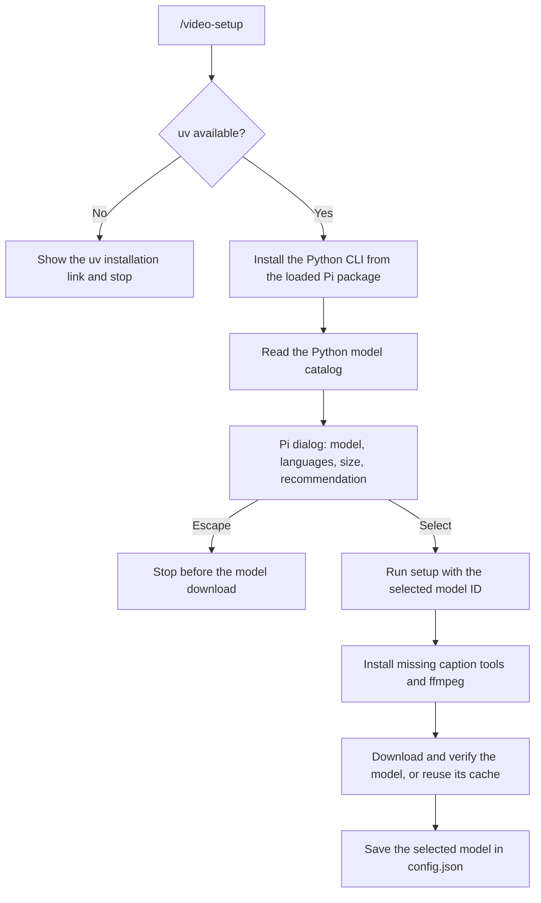
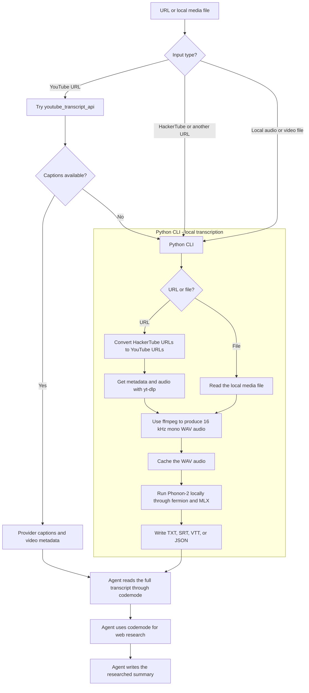
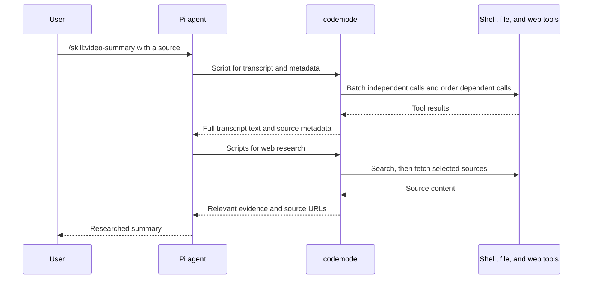

# video-transcriber

`video-transcriber` changes a video URL or a local media file into a transcript. It runs speech recognition locally on Apple silicon. It does not send audio to an external transcription service.

The tool accepts HTTP and HTTPS URLs that yt-dlp supports. It also accepts local audio and video files that ffmpeg supports.

## Requirements

- macOS on Apple silicon.
- `uv` for Python commands and Python 3.12.
- Pi with `codemode` for the summary skill. The setup command needs no `codemode`.
- Homebrew if ffmpeg is missing.

Install `uv` with the instructions at https://docs.astral.sh/uv/.

## Install with Pi

Install the Pi package:

```bash
pi install https://github.com/Kovaxs/video-transcriber
```

Run the setup command in Pi:

```text
/video-setup
```

The command installs the Python CLI from the same package that Pi loads. It does not fetch another repository version.

The command reads the Python model catalog and opens a Pi selection dialog. Each option shows the model, supported languages, download size, and recommendation.

Select a model with the arrow keys and press Enter. Press Escape to cancel before the model download.

The command then installs missing caption tools and ffmpeg. It downloads the selected model and saves the selection. The command shows progress and errors in Pi. It does not use a terminal prompt.

After a package update, run `/reload` in Pi to load the command. Run `/video-setup` again to change the model.

The setup uses `uv tool` for Python commands. It uses Homebrew for ffmpeg. The `fermion` command downloads and verifies the model weights.

## Manual installation

Install the CLI without Pi:

```bash
uv tool install --python 3.12 \
  git+https://github.com/Kovaxs/video-transcriber.git
```

Run the interactive setup:

```bash
video-transcriber setup
```

For a non-interactive setup, select a catalog model by ID:

```bash
video-transcriber setup --model phonon-2
```

## Supported models

| Model | Catalog ID | Languages | Download | Status |
|---|---|---|---:|---|
| Phonon-2 | `phonon-2` | English only | 158 MB | Recommended |

Phonon-2 runs locally through MLX. It provides punctuation, capitalization, segments, and word timestamps.

Print the catalog as JSON without a model download:

```bash
video-transcriber models
```

The CLI accepts only models from this catalog. It does not accept arbitrary model names. A maintainer must add each supported model and all its languages.

To request another model, open an issue:

https://github.com/Kovaxs/video-transcriber/issues

Include the model name, its languages, and a link to its documentation.

## Transcribe

Write plain text to standard output:

```bash
video-transcriber transcribe ./talk.mp4
```

Write subtitles to a file:

```bash
video-transcriber transcribe ./talk.mp4 --format srt --output talk.srt
```

Transcribe a HackerTube video:

```bash
video-transcriber transcribe \
  https://hackertube.org/watch/S4gU2Tsv6hY \
  --format json --output iroquois.json
```

The supported formats are `txt`, `srt`, `vtt`, and `json`. The JSON format includes source metadata, segments, and word timestamps. The default format is `txt`.

Use `--cache-dir` to select another audio cache:

```bash
video-transcriber transcribe ./talk.mp4 --cache-dir /tmp/media-cache
```

## Pi skill

Transcribe and summarize a video:

```text
/skill:video-summary <video-url>
```

Use a local file path instead of a URL for a local audio or video file. The skill uses provider captions when they exist. It uses local transcription when captions do not exist. It reads the full transcript before it writes a researched summary.

## How the tool works

The project has 3 parts:

| Part | Job | Uses a language model? |
|---|---|---|
| Pi setup extension | Install the CLI, show the model dialog, and run setup. | No |
| Python CLI | Prepare audio, run Phonon-2 locally, and write transcript files. | No |
| Pi summary skill | Choose the transcript path, read the transcript, research the topic, and write the summary. | Yes, the configured Pi language model |

### Setup

Enter `/video-setup` in Pi. The extension runs commands directly through `pi.exec()` and shows the model dialog through `ctx.ui.select()`.



Only Phonon-2 appears in the current catalog. It supports English only. A maintainer must add each new model and its supported languages.

The extension installs the CLI before the model dialog. Escape leaves the CLI installed, but it starts no model download.

### Transcript paths

Enter `/skill:video-summary <URL-or-local-path>`. The agent follows the skill and chooses the transcript path.



For YouTube URLs, the skill first tries provider captions. That path needs no audio download or speech recognition.

For HackerTube URLs and other URLs, the skill uses the Python CLI directly. HackerTube URLs contain a YouTube video ID. The CLI uses that ID to construct the YouTube source URL.

For local files, ffmpeg extracts the audio without a download. The CLI uses the file name without its extension as the title.

The CLI reuses cached audio when possible. It still runs transcription on each request. It does not cache transcripts or summaries.

TXT contains the transcript text. SRT and VTT contain subtitle segments. JSON also contains source metadata, word timestamps, model details, and timing measurements.

**The CLI does not check for captions or choose between the transcript paths.** A direct `video-transcriber transcribe` command always uses local speech recognition.

### Agent tool calls through codemode

`codemode` runs short JavaScript scripts that call Pi tools. The skill requires it for all agent shell commands, file reads, and web research.

The agent batches independent calls in one script. For example, it can get provider captions and video metadata at the same time.

The agent keeps dependent steps in order. It must finish transcription before it reads the transcript. It must read the full transcript before it writes the summary.



Only script output reaches the agent. Scripts omit duplicate word arrays, segment arrays, and web page content when the summary does not need them.

Scripts must not omit transcript text. The agent must read every transcript chunk. For a transcript-only request, the skill returns the transcript without a researched summary.

This approach can reduce agent turns and duplicate tool output. It does not reduce the local transcription work or guarantee a specific time or cost reduction.

### Enable codemode

Start Pi with `codemode`:

```bash
pi --tools +codemode
```

For persistent access, merge this setting into `~/.pi/agent/settings.json`:

```json
{
  "defaultTools": ["+codemode"]
}
```

This setting enables `codemode`, but it still exposes direct tools. The skill instructs the agent to use `codemode` for every tool action.

For stricter tool access, also set `codemode.mode` to `only`:

```json
{
  "defaultTools": ["+codemode"],
  "codemode": {
    "mode": "only"
  }
}
```

This mode hides direct tools that scripts can call. The agent reaches those tools through `codemode`. Merge these fields with existing settings; do not replace unrelated fields.

Reload Pi after a settings change. The package does not change your global Pi settings. If `codemode` is unavailable, the skill stops and gives the enable command.

The setup extension and Python CLI do not use `codemode`. They execute fixed code without agent model calls.

### Privacy and network use

The Python CLI runs speech recognition locally. It sends no audio or transcript to an external transcription service.

Setup needs network access for missing packages and model files. URL inputs need network access for metadata, captions, and audio. A cached model and a local file need no network access for transcription.

The summary has a different privacy boundary. Pi sends transcript text to its configured language model. Web research also sends queries to external services. Local transcription does not make the summary workflow fully local.

## Configuration and cache

The setup saves the selected model in `~/.config/video-transcriber/config.json`. The `XDG_CONFIG_HOME` variable changes the parent configuration directory. The `VIDEO_TRANSCRIBER_CONFIG_DIR` variable changes the full configuration directory.

Without a configuration file, the CLI uses the recommended model.

The default audio cache is `~/.cache/video-transcriber/audio`. The `XDG_CACHE_HOME` variable changes the parent cache directory. The `VIDEO_TRANSCRIBER_CACHE_DIR` variable changes the full cache directory.

Each URL has a separate cache entry. Each local file has a cache entry based on its path, size, and modification time. A later run reuses unchanged audio. Failed downloads and conversions do not create a cached WAV file.

The model uses the separate Fermion cache. Its default path is `~/.cache/fermion`.

## Development

Create the local environment:

```bash
uv sync
```

Run the unit tests:

```bash
uv run pytest
```

Run the Pi extension tests with Node.js 22.18 or later:

```bash
node --test tests/test_video_setup.mjs
```

Test the Pi dialog from the local package:

```bash
pi -e .
```

Then enter `/video-setup` in Pi.

Run the code checks:

```bash
uv run ruff check
uv run ruff format --check
uv run pyright
```

Unit tests do not use the network or a speech model. Integration tests use the `integration` marker and run only on request.
